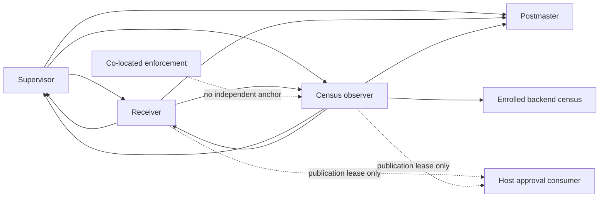

# Final finding criteria

This assessment becomes final only with complete `RECONCILIATION.json`, zero fresh FAIL and zero operational errors. Existing evidence is historical only; references below point to this batch.

| Finding | Status | Fresh evidence | Residual / severity |
|---|---|---|---|
| FC01 | OPEN | `17-frozen_execution_probe/RAW-QUALIFICATION.json`; exact frozen source and review provenance in `../HANDOFF-AUDIT.md` | Current approved promotion context and executable artifact absent. Historical baseline-bound interlock-copy mechanism exists, but current portability was not established. BLOCKER. |
| FC02 | PARTIAL | `02-census_probe`, `03-quarantine_probe`, `05-progress_probe`, `18-process_population_probe`, `19-finite_schedule_probe`, `20-compound_probe`, `22-extended_fault_probe` raw qualification | Selected census/heartbeat/identity/quarantine schedules run. Complete six-participant native identity and semantic-progress graph missing. HIGH. |
| FC03 | OPEN | `08-oid_probe/RAW-QUALIFICATION.json` | Protected tombstone/reuse denial is bounded native proof; no complete fresh allocation through promoted frozen positive joins. HIGH. |
| FC04 | PARTIAL | `07-replay_probe`, `21-successive_ceremony_probe` raw qualification | Genuine previous accepted approval replay denied at native boundary; full frozen accepted-consumption joins absent. MEDIUM. |
| FC05 | PARTIAL | `13-crypto_material_probe`, `21-successive_ceremony_probe` raw qualification | Genuine previous signed attestation and substituted material denied at native boundary; full frozen domain positive consumer absent. MEDIUM. |
| FC06 | PARTIAL | `05-progress_probe`, `14-storage_probe`, `22-extended_fault_probe`; `MEASUREMENTS.json` | Measured selected experimental populations only. Complete health/resource/drain worst-case population missing; no numeric candidate readiness. HIGH. |
| FC07 | PARTIAL | `04-drain_probe`, `09-domain_probe`, `12-restart_probe`, `16-participant_dead_probe` raw qualification | Selected actual async timer/signal/ownership preservation checks; full frozen claim/effect/terminal/retry/release/reconciliation population absent. MEDIUM. |

No security-review PASS grants runtime authority. No bootstrap denial proves full authority parity. No retained process anchor proves functional progress. No selected timing sample selects policy. Complete native identity, generation binding, independent health graph and full failure matrix remain HOLD. H01 remains OPEN; H02 and H03 remain HOLD; Room readiness is NO.

SCOPE01 (inherited downstream SQL extraction) is closed only by the successor's independent `synthetic_schema.py` and explicit blocked-domain register. `final-01` is invalidated and contributes zero assertions; its logs and the mistaken execution are preserved. The final batch must independently verify every bootstrap declares `NO_FROZEN_SQL_EXTRACTION`, exact compiler-source equality and complete cleanup. Positive frozen-domain constraints and transitions previously tested out of context are now explained NOT_RUN, never inherited PASS. The final raw denominator retains their exact IDs.

## Required positive pipeline (not executed)

Claim -> verification -> admission -> ownership acquisition -> effect -> terminalization -> retry guard -> retention -> release -> reconciliation requirement -> reconciliation completion -> full authority/source/accepted-consumption joins -> actual runtime consumer. Each stage requires the same current promoted frozen successor. Extracted DDL or hand-written synthetic rows cannot replace it. Full parity is NOT_RUN until that artifact and current promotion context exist.

## Independently observed graph

Solid edges denote current selected external observations, not proof of all nine dimensions. Dashed edges identify incomplete independent participant observation. Reciprocal observations never substitute for completed functional work or a separately validated generation. Proposed completeness requires an anchored native approval producer and enforcement participant plus external progress observers; this research contract does not provision them or extend approved protocol V1.
